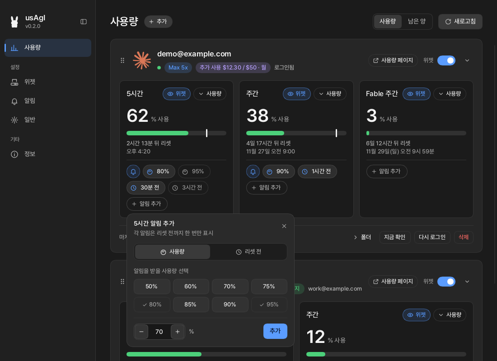

# usAgI

Claude와 ChatGPT(Codex) 구독 사용량을 작업 표시줄과 메뉴 막대에 항상 표시하는 프로그램.


5시간·주간 한도를 얼마나 썼는지, 언제 리셋되는지 창을 열지 않고 확인 가능.
Windows는 작업 표시줄 위젯, macOS는 메뉴 막대에 표시.

## 장점

| | |
|---|---|
| **가벼움** | 메모리 약 8MB (Windows), 약 14MB (macOS). CPU 사용 0.1% 미만 |
| **정확** | 공식 CLI가 알려 주는 수치 그대로 표시. 추정 없음 |
| **안전** | 로그인과 토큰은 공식 CLI가 관리. usAgI는 읽거나 저장하거나 전송하지 않음 |
| **간단** | 실행 파일 하나. 설치 과정 없음 |

메모리와 CPU는 0.2.0을 실행해 측정한 값 (작업 관리자·활성 상태 보기의 메모리 기준, Windows는 계정 2개 연결 상태에서 60초).
설정 창은 열 때만 실행되고(약 7MB) 닫으면 종료.

## 기능

- **위젯**: 계정·그래프별로 표시할 항목 선택. 퍼센트 또는 리셋까지 남은 시간 표시
- **계정 여러 개**: Claude와 ChatGPT·Codex 계정을 함께 관리. 5시간·주간·모델별 한도, 크레딧, 리필권 표시
- **알림**: 사용량 기준(예: 80%), 리셋 전 시점(예: 30분 전), 한도 도달·리셋, 로그인 만료, 리필권 만료
- **화면 설정**: 테마(시스템·라이트·다크), 언어(한국어·English), 로고 색, 위젯 막대 길이
- **자동 업데이트**: 체크섬과 서명을 확인한 파일만 설치


| 알림 추가 | 라이트 테마 · English |
|---|---|
|  |  |

작업 표시줄 자리가 좁으면 위젯이 단계적으로 축소:


## 작동 방식

1. 계정을 추가하면 공식 CLI(Claude Code, Codex)의 로그인이 브라우저에서 진행. CLI가 없으면 각 회사의 공식 설치 프로그램으로 자동 설치
2. 설정한 주기(기본 5분)마다 공식 CLI에 사용량 요청 (`claude -p "/usage"`, `codex app-server`). 토큰을 쓰지 않고 5시간 창도 열지 않음
3. Claude Code를 쓰는 동안에는 상태 표시줄 연결로 메시지마다 바로 갱신
4. 받은 수치를 위젯에 그리고, 정한 기준에 도달하면 알림 표시

브라우저 쿠키와 공급자 웹 API는 사용하지 않음.
외부로 나가는 요청은 GitHub 업데이트 확인과 공식 CLI 설치 스크립트 내려받기뿐.

## 설치

[Releases](../../releases)에서 내려받기. 필요한 것: 인터넷 연결, Claude 또는 ChatGPT 계정.

**Windows 10 / 11**

- `usagi.exe`를 받아 실행 (설정은 `%APPDATA%\usAgI`에 저장)
- 폴더째 옮겨 쓰려면 `usAgI-portable-x.y.z.zip` (설정은 옆의 `data` 폴더에 저장)
- 포터블 주의: 계정을 추가하면 `data\profiles`에 공식 CLI의 로그인 파일이 생기므로 `data` 폴더는 공유 금지

**macOS**

```bash
curl -fsSL https://raw.githubusercontent.com/Ba-koD/usAgI/main/scripts/install-mac.sh | bash
```

또는 `brew install --cask Ba-koD/usagi/usagi`.

## 사용법

| 동작 | 결과 |
|---|---|
| 위젯 더블클릭 | 설정 창 |
| 위젯 우클릭 | 퍼센트 ↔ 리셋까지 남은 시간 |
| 알림 영역 아이콘 우클릭 | 설정 열기 · 위젯 표시 · 새로고침 · 종료 |
| 설정 → 사용량 → **추가** | Claude 또는 ChatGPT·Codex 계정 연결 |
| 그래프의 **알림 추가** | 사용량 기준이나 리셋 전 시점 알림 |

## 문서

- [개발 문서](docs/DEVELOPMENT.md): 사용량 출처, 업데이트·보안, 빌드, 릴리스, 코드 구조
- [변경 내역](CHANGELOG.md)
