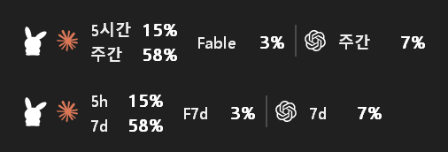
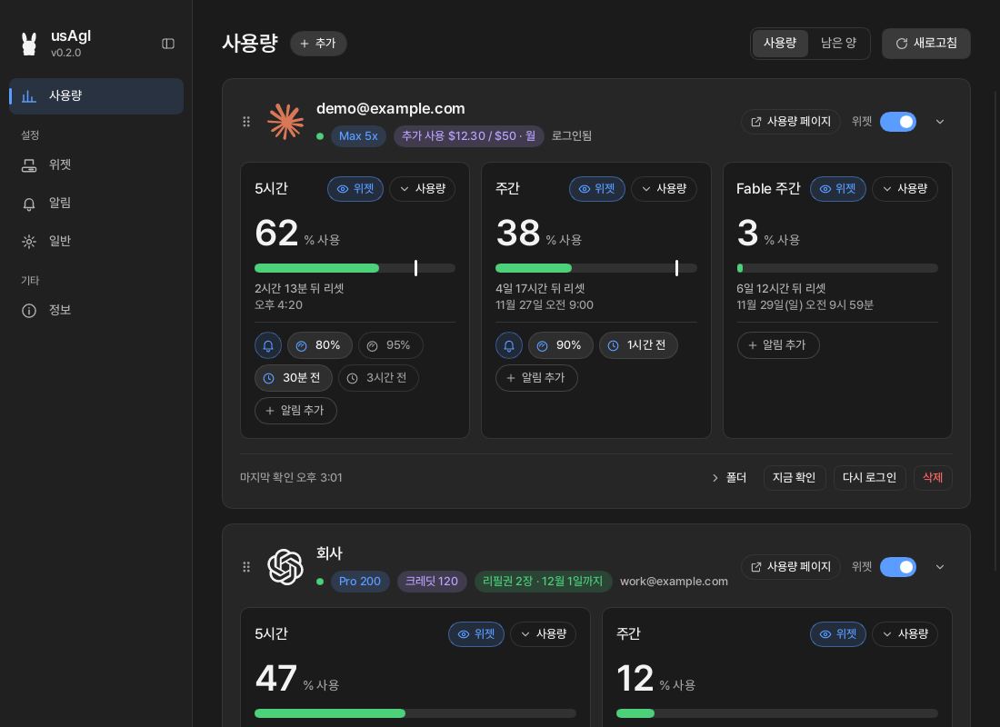
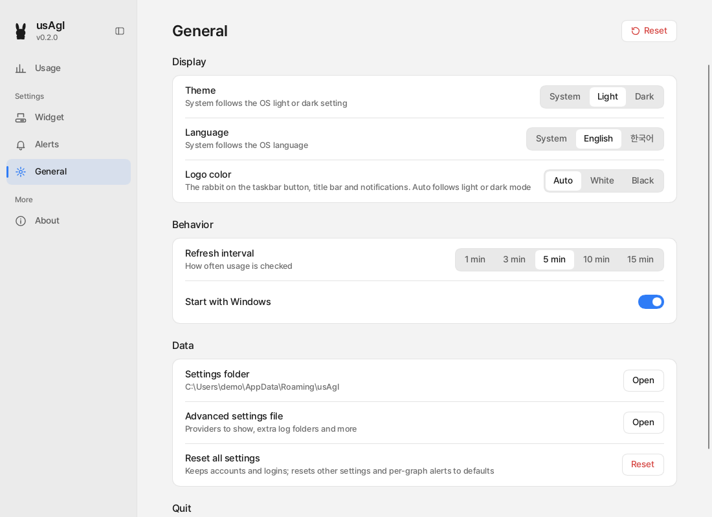
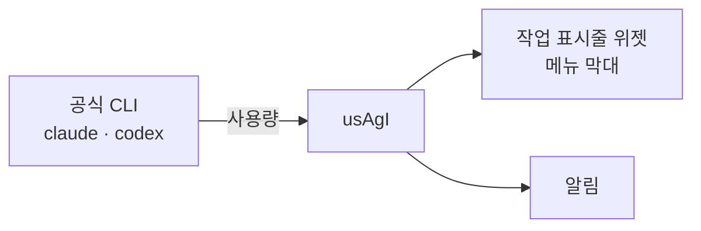

<div align="center">

<picture>
  <source media="(prefers-color-scheme: dark)" srcset="docs/images/logo-dark.png">
  
</picture>

# usAgI

**Claude와 ChatGPT 구독 사용량을 작업 표시줄에서 바로 확인**

[](https://github.com/Ba-koD/usAgI/releases/latest)
[](https://github.com/Ba-koD/usAgI/actions/workflows/release.yml)


[내려받기](https://github.com/Ba-koD/usAgI/releases/latest) · [기능](#기능) · [설치](#설치) · [작동 방식](#작동-방식) · [개발 문서](docs/DEVELOPMENT.md)


</div>

## 소개

Claude Code나 Codex를 쓰다가 한도가 얼마나 남았는지 확인하려면 `/usage`를 입력하거나 사용량 페이지를 열어야 함.
usAgI는 그 수치를 Windows 작업 표시줄과 macOS 메뉴 막대에 항상 표시하고, 정해 둔 기준에 도달하면 알림을 보내는 프로그램.

- 공식 CLI가 알려 주는 수치를 그대로 표시 (추정 없음)
- 로그인과 토큰은 공식 CLI가 관리 (usAgI는 읽거나 저장하거나 전송하지 않음)
- Rust로 만든 단일 실행 파일, 실행 중 메모리 약 8MB

## 기능

### 작업 표시줄 위젯

계정과 그래프별로 표시할 항목을 고르고, 퍼센트와 리셋까지 남은 시간을 우클릭으로 전환.
작업 표시줄 자리가 좁으면 막대 → 라벨과 값 → 짧은 표기 순서로 자동 축소.

<p align="center"></p>

### 계정과 사용량

Claude와 ChatGPT·Codex 계정을 여러 개 연결.
5시간·주간·모델별 한도와 리셋 시각, 크레딧, 리필권을 한 화면에 표시.

<p align="center"></p>

### 알림

그래프마다 사용량 기준(예: 80%)이나 리셋 전 시점(예: 30분 전)을 추가.
한도 도달·리셋, 로그인 만료, 리필권 만료 알림도 선택 가능.

<p align="center"></p>

### 화면 설정

테마(시스템·라이트·다크), 언어(한국어·English), 로고 색, 위젯 막대 길이 변경.

<p align="center"></p>

## 설치

필요한 것: 인터넷 연결, Claude 또는 ChatGPT 계정.

### Windows 10 / 11

[최신 릴리스](https://github.com/Ba-koD/usAgI/releases/latest)에서 파일을 받아 실행. 설치 과정 없음.

| 파일 | 설명 |
|---|---|
| `usagi.exe` | 실행 파일. 설정은 `%APPDATA%\usAgI`에 저장 |
| `usAgI-portable-x.y.z.zip` | 포터블. 설정을 옆의 `data` 폴더에 저장 |

> [!NOTE]
> 포터블에서 계정을 추가하면 `data\profiles`에 공식 CLI의 로그인 파일이 생김. `data` 폴더는 다른 사람과 공유 금지.

### macOS

```bash
curl -fsSL https://raw.githubusercontent.com/Ba-koD/usAgI/main/scripts/install-mac.sh | bash
```

업데이트도 같은 명령으로 실행.

### 처음 실행

1. 위젯을 더블클릭해 설정 창 열기 (macOS는 메뉴 막대 아이콘 → 설정)
2. 사용량 화면의 **추가**에서 Claude 또는 ChatGPT·Codex 선택
3. 브라우저에서 로그인 승인. 이 PC에 이미 로그인된 CLI가 있으면 바로 연결

## 사용법

| 동작 | 결과 |
|---|---|
| 위젯 더블클릭 | 설정 창 |
| 위젯 우클릭 | 퍼센트 ↔ 리셋까지 남은 시간 |
| 알림 영역 아이콘 우클릭 | 설정 열기 · 위젯 표시 · 새로고침 · 종료 |
| 그래프의 **알림 추가** | 사용량 기준이나 리셋 전 시점 알림 추가 |
| 계정 카드 왼쪽 ⠿ 끌기 | 계정 순서 변경 (위젯도 같은 순서) |

## 작동 방식



1. 계정을 추가하면 공식 CLI(Claude Code, Codex)의 로그인이 브라우저에서 진행. CLI가 없으면 각 회사의 공식 설치 프로그램으로 자동 설치
2. 설정한 주기(기본 5분)마다 공식 CLI에 사용량 요청 (`claude -p "/usage"`, `codex app-server`). 토큰을 쓰지 않고 5시간 창도 열지 않음
3. Claude Code를 쓰는 동안에는 상태 표시줄 연결로 메시지마다 바로 갱신
4. 받은 수치를 위젯에 그리고, 정한 기준에 도달하면 알림 표시

## 리소스 사용량

0.2.0을 실제로 실행한 상태에서 60초 동안 측정한 값.

| 프로세스 | 메모리 | CPU |
|---|---|---|
| Windows 본체 (위젯 + 알림 영역) | 약 8MB | 0.1% 미만 |
| Windows 설정 창 (열려 있을 때만) | 약 7MB | 0.1% 미만 |
| macOS 본체 (메뉴 막대) | 약 14MB | 0.1% 미만 |

- 메모리는 작업 관리자와 활성 상태 보기에 표시되는 값 기준. Windows는 계정 2개를 연결한 상태
- 설정 창은 별도 프로세스로 실행되고, 닫으면 종료
- 갱신 주기마다 공식 CLI가 몇 초 실행되며, 그 사용량은 위 값에 포함되지 않음

## 개인정보와 보안

- **로그인 정보**: 공식 CLI가 보관. usAgI는 토큰과 로그인 파일을 읽지 않음
- **네트워크**: GitHub 업데이트 확인·내려받기와 공식 CLI 설치 스크립트 내려받기뿐. 사용 정보 수집 없음
- **업데이트**: 이 저장소의 릴리스 파일만 허용. 체크섬과 서명을 모두 확인한 뒤 설치
- **프로필 폴더**: 계정마다 만드는 폴더는 이 사용자만 접근 가능하게 생성

자세한 내용은 [개발 문서](docs/DEVELOPMENT.md) 참고.

## 문서

- [개발 문서](docs/DEVELOPMENT.md): 사용량 출처, 업데이트와 서명, 빌드, 릴리스, 코드 구조
- [변경 내역](CHANGELOG.md)
